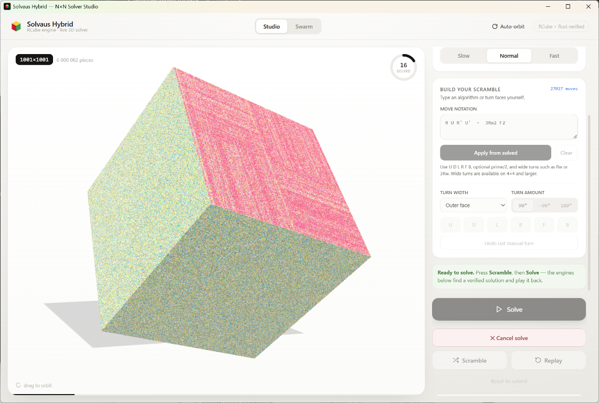
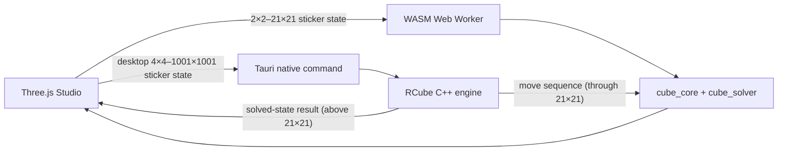

<div align="center">
  

# Solvaus-hybridi

**A local-first N×N cube solver combining RCube's large-cube engine with Cube-Solver's live Three.js animation.**

Create a legal scramble, solve from the visible stickers alone, and watch the solution animate on the 3D cube.



Solvaus-hybridi is distributed under **GPL-3.0** because it integrates RCube; see [`LICENSE`](LICENSE) and the upstream copy at [`src-tauri/rcube/LICENSE`](src-tauri/rcube/LICENSE) (from [ShellPuppy/RCube](https://github.com/ShellPuppy/RCube)).

> [!NOTE]
> **Credits.** This project is mostly based on two existing projects. [Cube-Solver](https://github.com/AdamNolle/Cube-Solver) by Adam Nolle provides the Rust cube model, solvers, WASM bridge, Three.js studio UI, and animation. **[RCube](https://github.com/ShellPuppy/RCube)** (bundled in [`src-tauri/rcube`](src-tauri/rcube), GPL-3.0) provides the C++ large-cube engine and scrambler used by the native desktop app. Solvaus-hybridi combines the two, adds the Tauri desktop bridge, larger supported sizes, and solve-progress estimates.

[](https://www.rust-lang.org/)
[](src-tauri/rcube)

</div>

> [!IMPORTANT]
> **Solvaus-hybridi offers sizes supported by its solver and renderer.**
> The native desktop app supports **2×2–1001×1001**; the standalone browser supports **2×2–21×21**. Browser solves from 9×9 to 21×21 may take up to 10 minutes; desktop solves remain bounded by a five-minute deadline. Both can be cancelled.

## What you can do

- **Generate legal scrambles** locally; desktop 4×4–1001×1001 cubes use RCube's native scramble routine.
- **Render larger cubes from sticker textures** above 21×21 instead of creating a separate 3D mesh for every cubie.
- **Build your own scramble** by typing standard notation such as `R U R' U'`, `Rw`, or `3Rw2`.
- **Turn the cube yourself** with accessible face, direction, and wide-turn controls.
- **Solve without revealing the scramble history** to the Worker or native solver.
- **Cancel long solves or replays** without leaving the visual cube and Rust cube out of sync.
- **Inspect truthful solver telemetry** while 4×4+ cubes are solved, including live elapsed time during solving and animation, plus a stage-based percentage estimate (desktop and browser) that does not predict remaining time.

## A 60-second tour

1. **Choose a supported size.** Desktop offers 2×2 through 1001×1001; browser offers 2×2 through 21×21.
2. **Create the state.** Press **Scramble**, enter an algorithm, or turn faces manually.
3. **Press Solve.** The solver receives the complete sticker-color state—not the scramble sequence.
4. **Wait or cancel.** Small cubes run in a Web Worker; browser 4×4–21×21 solves use bounded WASM reduction, while desktop uses the cancellable native RCube engine.
5. **Replay the solution.** Smaller cubes replay solver moves through the cube model; native cubes above 21×21 use RCube's solved-state result.
6. **Watch the 3D animation.** The existing Cube-Solver renderer animates the returned move sequence in real time.

## What solves each cube?

| Where | Size | Solver path | Execution |
|---|---:|---|---|
| Browser + desktop | **2×2** | Bounded meet-in-the-middle, beam, and island-GA strategies; shortest verified candidate wins | WASM Worker |
| Browser + desktop | **3×3** | Two-phase Kociemba-style search | WASM Worker |
| Standalone browser | **4×4–21×21** | Deterministic reduction | Rust/WASM Worker |
| Native desktop | **4×4–1001×1001** | RCube scramble and center, corner, and edge engine | Native C++ command thread |

The 3×3 path is a fast two-phase solver, **not an optimal solver**. Desktop large cubes use RCube, whose center/edge strategy is designed for large N. For native cubes above 21×21, the UI uses RCube's solved-state result directly. Browser builds use the Rust reduction path, with a 570-second solver deadline and a 10-minute UI watchdog for 9×9–21×21. A six-wide-turn 21×21 WASM smoke solve and replay completed in about 67 seconds locally; harder states and slower devices may take longer or time out.

### Choosing a solver (desktop, 4×4 and larger)

A **Solver** dropdown above the Solve button picks the engine: **RCube**, **Gullicube**, or **Competition**, which runs both in parallel and plays back the shorter solution (the lanes show each engine's move count and time). [Gullicube](src-tauri/gullicube) is vendored C++ (GPL-3.0 / MPL-2.0, see its license files) that runs as a child process; it can use roughly 3 GB of memory and loads about 30 MB of data files. `src-tauri/build.rs` compiles it to `gullicube[.exe]` plus a `data/` folder beside the app binary. It needs `g++` or `clang++` on `PATH` (or `GULLICUBE_CXX`); the MSVC toolchain cannot build it. Without one, the build still succeeds and the Gullicube options show as "not installed". `SOLVAUS_GULLICUBE` can point at a prebuilt executable. Installers bundle it under `gullicube-runtime/` next to the app (staged in `src-tauri/gullicube-bundle`), provided the build machine had a compiler.

### Large-cube limits

The native desktop maximum is 1001×1001. Large cubes use the existing texture-based renderer above 21×21 rather than creating an individual 3D object for every cubie. Release-mode integration tests solve and independently replay representative odd and even states through 101×101; the 1001×1001 cap is currently covered by scramble-legality checks only, so very large solves are bounded by the five-minute deadline and may time out depending on the device. RCube's storage uses the next power-of-two face stride; larger cubes remain capped until runtime, memory use, UI responsiveness, and replay are tested across supported platforms.

Every advertised size must pass all of these gates:

- legal-move solving from sticker colors,
- independent replay to solved,
- bounded memory and runtime on ordinary machines,
- cancellation without state corruption,
- repeatable tests on Linux, macOS, and Windows.

Research-only replay evidence currently reaches beyond the product ceiling, including strict runs through N=44, but frontier cases can consume substantial time and memory. The UI therefore stops at the range we can defend as a real desktop feature. See [`docs/ARBITRARY_N_RESEARCH.md`](docs/ARBITRARY_N_RESEARCH.md) for the evidence and remaining limits.

## Build your own scramble

### Type move notation

Examples:

```text
R U R' U'
R2 F2 U2
Rw U 3Rw2 F'
```

Supported notation:

- faces: `U D L R F B`,
- counter-clockwise suffix: `'`,
- half-turn suffix: `2`,
- wide turns: `Rw` or `3Rw`,
- lowercase wide-turn aliases such as `r`.

Wide turns are available on 4×4 and larger cubes and are limited to half the cube width. That keeps the fixed face orientation compatible with the supported solver paths. Custom 2×2 sequences are capped at nine moves so the exact bounded search can always search at least as deep as the entered sequence.

### Turn faces interactively

Choose:

1. the turn width,
2. `90°`, `−90°`, or `180°`,
3. one of `U D L R F B`.

Each press applies a real legal move to both the rendered cube and the Rust cube model. **Undo last manual turn** reverses the most recent interactive move. Applying notation starts from solved; interactive turns can be added to the current scramble.

## Solver inputs and privacy

Solvaus-hybridi is local-first:

- no cloud solver,
- no analytics runtime,
- no external fonts or JavaScript at runtime,
- vendored three.js,
- an offline-focused Tauri content-security policy.

For normal Studio solves, the Worker or Tauri command receives:

```text
N + exactly 6 × N² sticker-color values
```

It does **not** receive the scramble sequence. Browser and smaller native-cube paths replay returned moves from the original state. Native texture-rendered cubes above 21×21 use RCube's solved-state result directly.

This is an implementation fairness boundary—not a cryptographic proof—but it prevents the normal solver path from simply reading and reversing a hidden scramble history.

## Architecture



| Path | Responsibility |
|---|---|
| `crates/cube_core` | Sticker cube, legal face/wide/slice turns, scramble primitives |
| `crates/cube_solver` | Two-phase 3×3, bounded 2×2 strategies, EC workers, browser deterministic reduction |
| `crates/cube_wasm` | WASM bridge and browser sticker-only solve boundary |
| `src-tauri/rcube` | RCube C++ engine and sticker/move bridge |
| `src-tauri` | Native desktop shell and cancellable RCube solves |
| `tools/design-source.txt` | Authored Studio interface |
| `tools/gen-index.py` | Generates `web/index.html` and wires the real solver into the interface |
| `web/solver-worker.js` | Off-main-thread browser/WASM solving |
| `crates/solver_lab_app` | Legacy/experimental egui frontend |

## Run locally

### Prerequisites

- stable Rust,
- Python 3,
- the `wasm32-unknown-unknown` target,
- [`wasm-pack`](https://rustwasm.github.io/wasm-pack/),
- [Tauri CLI v2](https://v2.tauri.app/start/prerequisites/),
- platform-specific Tauri system dependencies,
- a C++17 compiler for the native RCube engine.

```sh
rustup target add wasm32-unknown-unknown
cargo install tauri-cli --version '^2' --locked
```

### Native desktop app

```sh
cd src-tauri
cargo tauri dev
```

The Tauri configuration builds the WASM package automatically before development and production builds.

```sh
cd src-tauri
cargo tauri build
```

### Standalone browser

```sh
python3 tools/build-wasm.py
python3 -m http.server -d web 8000
```

Then open <http://localhost:8000>. ES modules and WebAssembly must be served over HTTP; opening `web/index.html` through `file://` will not work.

### Legacy Solver Lab

```sh
cargo run --release -p solver_lab_app
```

The egui Solver Lab is an experimental second frontend with its own controls, local SQLite history, and wall view. It should not be confused with the recommended Tauri Studio documented above.

## Developer notes

### Canonical verification gate

```sh
cargo fmt --all -- --check
python3 tools/gen-index.py --check
python3 tools/frontend-smoke.py
cargo clippy --workspace --all-targets --all-features -- -D warnings
cargo test --workspace
cargo build -p cube_wasm --target wasm32-unknown-unknown
cargo build --release --workspace
cargo check --manifest-path src-tauri/Cargo.toml
node --check web/solver-worker.js
```

After generating `web/pkg/`, also run:

```sh
node tools/wasm-runtime-smoke.mjs
```

Slow reduction corpora and frontier research tests are intentionally ignored by routine `cargo test`; release workflows invoke the advertised-range gates explicitly.

### Generated frontend

Do not hand-edit `web/index.html`.

1. Edit `tools/design-source.txt` for authored layout/interaction changes.
2. Edit `tools/gen-index.py` for solver wiring and runtime behavior.
3. Run `python3 tools/gen-index.py`.
4. Run `python3 tools/frontend-smoke.py`.

`src-tauri/build.rs` rejects missing or obviously incomplete generated output. CI’s exact `gen-index.py --check` gate detects generator drift.

### Two Cargo workspaces

The root Rust workspace contains the cube crates and legacy app. `src-tauri` is a separate workspace. Run Tauri-specific format, Clippy, tests, and packaging commands from `src-tauri/` or with `--manifest-path`.

### Troubleshooting

Avoid keeping active build trees in a cloud-synchronized folder. Sync tools can duplicate or replace generated sources while Tauri embeds them, producing a package from stale assets.

## Releases

The release workflow produces three native desktop downloads:

- Windows x86_64: NSIS setup `.exe`,
- macOS universal: `.dmg`,
- Linux x86_64: `.flatpak` bundle using the GNOME 50 runtime.

The `v0.1.0` packages are published **unsigned** by explicit owner decision. Apple notarization and Windows publisher signing are not configured, so Gatekeeper and SmartScreen warnings are expected. The Flatpak is a single-file application bundle; Flatpak downloads its declared GNOME runtime from Flathub when needed.

The packages are structurally validated, replay-tested, checksum-verified, and provenance-attested, but those checks do not establish a trusted publisher identity.

See [`docs/RELEASING.md`](docs/RELEASING.md) for artifact contracts, validation steps, signing requirements, and the draft-to-public checklist.
